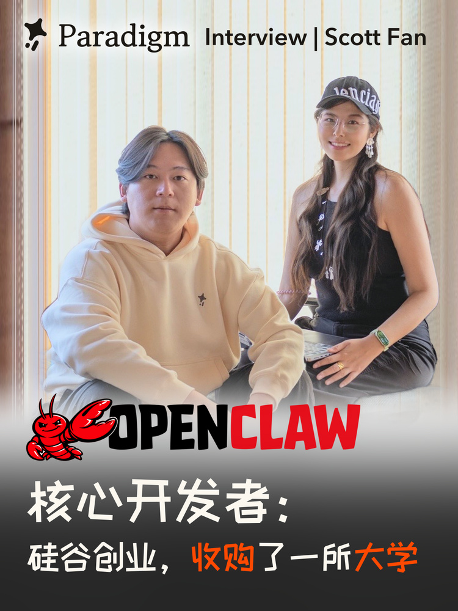

# Scott Fan：字体选择与后续发布布局

Scott这一期，Cathy明确回选站酷快乐体以呼应OpenClaw字标。之后又要求“只换回附图字体，保留标题在上”、去掉左侧淡棕边而保留Cathy右侧背景、加入红色“小龙虾”，再让两行中文同字号。后续明确将“核心开发者”改为“官方开发者”，形成当前V9；这条新文案覆盖V8，不改变已选字体和布局。



[scott-approved-layout.json](../assets/scott-approved-layout.json)记录V9修改记录、当前可读取JPG和新预览的哈希。修改记录与实际JPG确认这次改字已生成；没有单独记录对V9整图的明确确认，不能将其写成已完整批准。预览由V9 JPG缩小，不是原人物层。

## 当前文案与视觉

```text
OpenClaw 原字标
小龙虾官方开发者
硅谷创业，收购了一所大学
```

“小龙虾”为字标中的红色 `#F8000C`；“收购”“大学”为 `#FF4900`；其他中文 `#242421`。不增加旧版冒号。两行中文都由116px站酷快乐体排出，再按当前标题组.95等比缩放。主标题不再为了身份特意放大；这条后来明确指令覆盖早先“身份最大”的选择。

V9的独立主标题透明层实测为803×95px，alpha≥16的可见框为[0,0,803,95]；按修改记录的位置[69,358]放回画布，得到[69,358,872,453]。新字的外框恰好与V8相同，这是重新测量结果，不是按旧字假定。约77/78px的前后间距是既有布局记录；修改记录报告字标、副标题和其他画面不变，没有从有损JPG重新证明整图像素相等。原字体仍为站酷快乐体，不套Photon的紧凑科技。

V9修改记录报告仅替换字形改变：10770个像素，差分范围[370,359,571,453]；“小龙虾”“开发者”和其他画面保持像素一致。这里引用的是生成时的检查记录；当前可核验的是实际JPG、透明标题层与各文件哈希，不能把JPG压缩后的差异当成原PNG差分结果。

上部直接使用浅色窗帘背景，不加厚白板。两人在中下部，Scott偏左更大，Cathy右后方但有独立轮廓。保留Cathy右边的自然淡棕背景，只去掉用户指定的左侧边条。底部照片轻微虚化，品牌署名“Paradigm Interview | Scott Fan”保留，不含平台头像、账号、点赞或播放标。

## 当前尺寸与署名

输出为1438×2000：源1500×2000左裁62px，竖向坐标不变。它并非数学上的3:4；新封面去柱子不能无意复制这个画幅改变，若需严格3:4，优先在背景层处理并重新验证平台裁切。

品牌署名沿用既有布局记录的可见框[228,1700,1360,1796]，高96px、底边89.8%H；V9修改记录报告其他画面不变，这些数值不是从当前JPG重新提取的alpha边界。Photon底部组只有66px高，因此其顶边为1730，底边同为1796。跨期统一的是可见底边与UI避让，不是强迫两个Logo组顶边和字号一样。不同裁后画幅的水平对齐需重新测。

## 历史深底版本保留哪些经验

早期明确采用的版本为站酷快乐体、底部标题、连续白到深灰背衬。字母OPEN/CLAW与中文的可见字高约150px，整Logo的龙虾更高，两处行距56px。它教会的是分清字母墨迹、整个Logo边界、字重和对比度，不是永远保持150px或56px。

原字标后柔白、再连续过渡至深灰是针对黑裤子与浅色字的对比度修复；移到干净浅色上方后不必再垫白到黑。主标题后来变小，也不能继续用“要和OpenClaw整组同高”的历史要求盖过新指令。

素材靠近仍需避免捶背/搭肩错觉，已批准Cathy向右的关系不能随换字体悄悄还原。只动颜色或文字时保护人物像素，去一侧柱子时保护另一侧自然背景。

## 文件与事实边界

当前可读取的项目文件为 `outputs/Scott_Fan_发布海报_小龙虾官方开发者_v9_20261111/封面-Paradigm_小龙虾官方开发者.jpg`；同目录保存`修改记录.json`和`中文主标题透明层.png`。记录中的原PNG在其项目路径下未找到，因此JSON分别保存已核验JPG哈希与记录中的PNG哈希，不将后者标成已重新验证。追溯路径以`<interview-project-root>`为占位符，不是新任务依赖。

“小龙虾官方开发者”是用户后续明确指定的本期封面文案，不是对所有maintainer的统一翻译，也不是本技能独立核验的任职结论。不要把本期“收购大学”的句子或完成时态复制给其他人；新嘉宾以其材料和当前指令为准。
